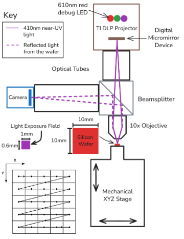
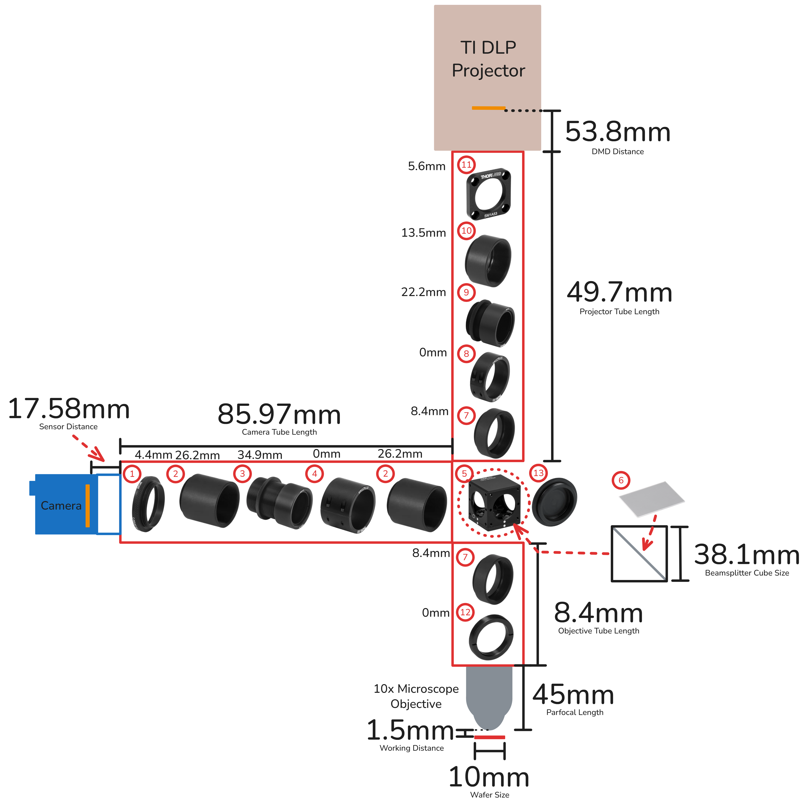

# Maskless Litho Stepper
The stepper will be used for patterning: transferring images of circuit designs onto a light-sensitive layer of photoresist. The current stepper setup has an optical theoretical resolution limit of .863um (wavelength = 410nm and NA = .28) defined by Rayleigh's criterion for lithography.

## Timeline

Goal: Pattern test lines on S1813 by end of November

| Phase | Dates
|---|---|
| CAD design | Tue Nov 17 
| 3D printing | Wed Nov 18 – Fri Nov 20
| Part assembly and testing | Mon Nov 23 – Tue Nov 24
| Buffer | Wed Nov 25 – Mon Nov 30 |

### Current Progress
- CAD assembly in Solidworks
- Tube lens, camera, and objective physical assembly
- Basler Pylon camera software installed
- Soldered inductive sensor, stepper motor, voltage-clamp diodes to the perf board

### CAD Design - Nov 17
- **LED PCB.** Resolve the heatsink issue for the 410 nm LED PCB order from JLCPCB and succesfully put down the order. The PCB will arrive in 2–3 business days 
- **Design 3D printed parts**
  1. Main frame design: Design the base the XYZ stage slots into, supports for the pillars, three legs that each stand on a tennis ball for vibration damping. Purchase 3 tennis balls on Amazon
  2. Wafer mount: adjust the height of the mount for the 10x Mitutoyo infinite-conjugate objective (the Hacker Fab design used a 10x Edmund Optics objective). The printed part has to put the wafer close enough to the objective's working distance (34mm) so that the stage's Z travel can bring it into focus
  3. Sensor mounts: make the sensor mount arm thicker because the old ones were fragile and tended to bend under the weight of the sensor
  4. Set the print settings and start printing the parts

### 3D Printing - Nov 18–20
- **3D printing:** continue to print the parts designed on Nov 17 in addition to the DLP controller support frame (available on Hacker Fab docs)
- **Projector assembly** (begin when PCB arrives)
  1. Test the projector as shipped and set the LED drive level to 150 in the LightCrafter GUI, so the new LEDs aren't overdriven
  2. Take apart the main casing
  3. Mount the DLP controller board on the printed support frame
  4. Fit the 410 nm LED PCB, with the LED housing and heatsink

### Part Assembly and Testing - Nov 23-24
- Part assembly: projector, lens tube + camera, xyz stage, and main frame
- Calibrate the XYZ stage and make sure homing repeats and moves match the commanded distance
- Focus the camera on a chip
- Install the [stepper GUI](https://github.com/hacker-fab/stepper) and connect it to the camera, stage and projector
- Testing: Pattern test lines on silicon wafers cleaved into squares from Prof. Jueng-Hyun Cho. The wafers will be coated with S1813 positive phtoresist using the Chemat Technology KW-4A spin coater. We will use in the Corning PC-420fD for dehydration and soft baking. The stepper will expose the test patterns and we will develop with acetone, water, and dry with N2 vapor gun

**Stepper BOM**

| Item | Qty | Unit Price | Line Total |
|---|---:|---:|---:|
| [TI DLP Evaluation Module](https://www.ti.com/tool/DLPDLCR471TPEVM) | 1 | $999.00 | $999.00 |
| [10X DIN Plan Commercial Grade Objective](https://www.edmundoptics.com/p/10x-din-plan-commercial-grade-objective/5386/) | 1 | $190.00 | $190.00 |
| [Basler ace U acA1920-40uc](https://www.baslerweb.com/en-us/shop/aca1920-40uc/) | 1 | $609.00 | $609.00 |
| [USB Type-A to Micro-B Locking Cable](https://www.amazon.com/dp/B0CWN9YLSB?th=1) | 1 | $6.99 | $6.99 |
| [19V 4.74A Projector Power Supply](https://www.amazon.com/dp/B074J81XRB) | 1 | $17.99 | $17.99 |
| [XYZ Stage (40 mm)](https://www.amazon.com/dp/B07D7N9GT6) | 1 | $125.00 | $125.00 |
| [NEMA 28 Stepper Motors](https://www.amazon.com/dp/B07PNV7RBW) | 3 | $17.99 | $53.97 |
| [Arduino Uno (Elegoo)](https://www.amazon.com/dp/B01EWOE0UU) | 1 | $16.99 | $16.99 |
| [CNC Shield for Arduino V3.0](https://www.amazon.com/dp/B07TT3C3HB) | 1 | $10.99 | $10.99 |
| [Stepper Motor Drivers](https://www.amazon.com/dp/B07ZPYKL46) | 1 | $22.99 | $22.99 |
| [Shield Power Supply (12 V)](https://www.amazon.com/dp/B01GEA8PQA) | 2 | $11.99 | $23.98 |
| [M2.5 Screw Assortment](https://www.amazon.com/dp/B08RRY72VG) | 1 | $68.16 | $68.16 |
| [410 nm Lumiled LED](https://www.digikey.com/en/products/detail/lumileds/L1F3-U400200012000/7389568) | 4 | $11.75 | $47.00 |
| [Pico-SPOX 10-Position Vertical Connector](https://www.digikey.com/en/products/detail/molex/0874371043/717647) | 2 | $0.90 | $1.80 |
| [Proximity Sensors (4-pack)](https://www.amazon.com/dp/B0DCMWDJ85) | 1 | $19.90 | $19.90 |
| [ThorLabs SM1A3](https://www.thorlabs.com/item/SM1A3) | 1 | $21.21 | $21.21 |
| [ThorLabs SM1V10](https://www.thorlabs.com/item/SM1V10) | 1 | $38.78 | $38.78 |
| [ThorLabs SM1L10](https://www.thorlabs.com/item/SM1L10) | 2 | $16.49 | $32.98 |
| [ThorLabs SM1A9](https://www.thorlabs.com/item/SM1A9) | 1 | $22.88 | $22.88 |
| [ThorLabs SM1L05](https://www.thorlabs.com/item/SM1L05) | 1 | $14.57 | $14.57 |
| [ThorLabs CM1-DCH/M](https://www.thorlabs.com/item/CM1-DCH_M) | 1 | $205.91 | $205.91 |
| [ThorLabs SM1CPL05](https://www.thorlabs.com/item/SM1CPL05) | 1 | $41.93 | $41.93 |
| [ThorLabs SM1L03](https://www.thorlabs.com/item/SM1L03) | 2 | $14.07 | $28.14 |
| [ThorLabs SM1V05](https://www.thorlabs.com/item/SM1V05) | 1 | $35.01 | $35.01 |
| [ThorLabs SM1A53](https://www.thorlabs.com/item/SM1A53) | 1 | $36.08 | $36.08 |
| [ThorLabs SM1CPL10](https://www.thorlabs.com/item/SM1CPL10) | 1 | $43.22 | $43.22 |
| [ThorLabs BSN10R](https://www.thorlabs.com/item/BSN10R) | 1 | $157.60 | $157.60 |
| [ThorLabs SM1CP2](https://www.thorlabs.com/item/SM1CP2) | 1 | $22.13 | $22.13 |
| [ThorLabs TR6-P5](https://www.thorlabs.com/item/TR6-P5) | 1 | $38.92 | $38.92 |
| **Total Build Price** | | | **$2,953.12** |

## Optics

1. [SM1A9](https://www.thorlabs.com/item/SM1A9)
2. [SM1L10](https://www.thorlabs.com/item/SM1L10) (2×)
3. [SM1V10](https://www.thorlabs.com/item/SM1V10)
4. [SM1CPL10](https://www.thorlabs.com/item/SM1CPL10)
5. [CM1-DCH/M](https://www.thorlabs.com/item/CM1-DCH_M)
6. [BSN10R](https://www.thorlabs.com/item/BSN10R)
7. [SM1L03](https://www.thorlabs.com/item/SM1L03) (2×)
8. [SM1CPL05](https://www.thorlabs.com/item/SM1CPL05)
9. [SM1V05](https://www.thorlabs.com/item/SM1V05)
10. [SM1L05](https://www.thorlabs.com/item/SM1L05)
11. [SM1A53](https://www.thorlabs.com/item/SM1A53)
12. [SM1A3](https://www.thorlabs.com/item/SM1A3)
13. [SM1CP2](https://www.thorlabs.com/item/SM1CP2)
14. [TR6-P5](https://www.thorlabs.com/item/TR6-P5)
