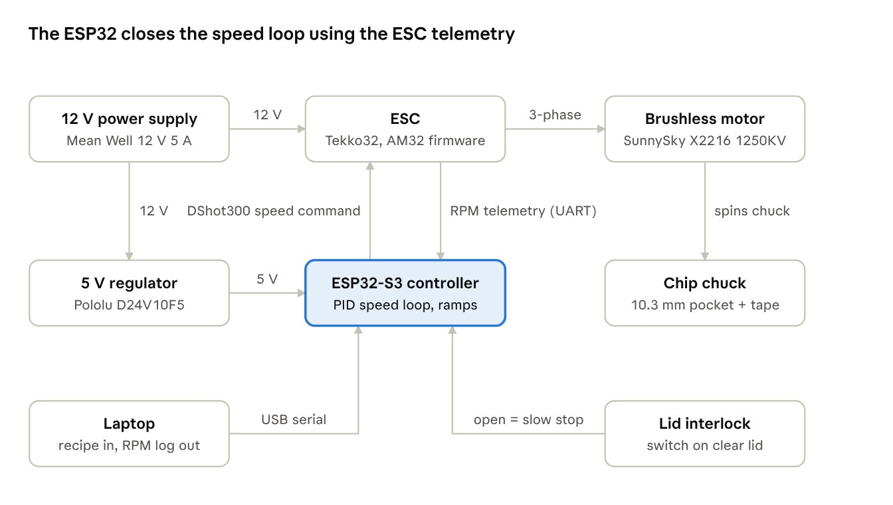

# Spinner

*Owner: Wenteng Li*

## Target Specs

The goal of this machine is to coat 10 × 10 mm silicon chips with photoresist and spin-on dopant at a repeatable, closed-loop speed, for Gen One's 10 µm NMOS process.

| Spec | Value |
|---|---|
| Substrate | 10 × 10 mm Si chips, about 525 µm thick |
| Speed | 500–6000 RPM closed loop; hardware headroom to about 10000 RPM (not yet tested) |
| Program | 300 RPM start, 1500 RPM/s ramp, 5–180 s hold, controlled ramp down |
| Chip holding | 10.3 mm recessed chuck + double-sided Kapton tape |
| Control | ESP32-S3, speed read from the ESC's serial telemetry |
| Safety | Clear polycarbonate lid with interlock switch; slow stop instead of hard brake |
| Size | 150 × 150 × 102 mm with lid |
| Purchased parts | about $85 |

## Where to start for new Members

* Read this page and the [CMU Hacker Fab spin coater docs](https://docs.hackerfab.org/home/fab-toolkit/spincoater), which our design follows.
* Ask Wenteng Li for the CAD generator, printable STL files and the team BOM sheet.
* Ask for help if you are unsure.

## Design

The chip sits in a recessed chuck inside a catch bowl, under an interlocked lid, and waste resist drains to a separate handling module.

The ESP32 sends a speed command to the ESC and reads the actual RPM back from the ESC's telemetry wire, so no separate tachometer is needed. Opening the lid triggers a slow ramp-down.

Mechanically, the motor sits in a printed base, three posts hold a catch bowl around the chuck, and the chip top sits 8.8 mm below the bowl rim.
### Changes from the CMU Hacker Fab design

| | CMU Hacker Fab V1 | UMN Spinner V1 |
|---|---|---|
| Controller | Raspberry Pi Pico | ESP32-S3 |
| Speed feedback | Bidirectional DShot telemetry | Separate ESC telemetry wire over UART |
| ESC | BLHeli_32, closed firmware | Tekko32 with open AM32 firmware |
| Chip holding | Tape on a flat chuck | Recessed 10.3 mm pocket + tape |
| User interface | 16 × 2 LCD + buttons | Laptop USB serial |
| Purchased cost | about $110 | about $85 |

## BOM

Nothing ordered yet. Prices checked 11/1/26.

| Part | Selection | Cost (USD) | Source |
|---|---|---|---|
| Brushless motor | [SunnySky X2216 1250KV](https://sunnyskyusa.com/products/sunnysky-x2216-brushless-motors) | 18.99 | To buy |
| ESC | Holybro Tekko32 F4 45A (AM32) | 23.99 | To buy |
| Power supply | [Mean Well GST60A12, 12 V 5 A](https://www.jameco.com/z/GST60A12-P1J-MEAN-WELL-12VDC-5A-60W-3-Wire-Desktop-Power-Adapter-with-2-1mm-Plug_2224382.html) | 19.40 + 21% tariff | To buy |
| 5 V regulator | Pololu D24V10F5 | 13.95 | To buy |
| Lid interlock switch | Omron SS-5GL | 2.09 | To buy |
| DC jack | 2.1 mm to screw terminal | 2.00 | To buy |
| Controller | ESP32-S3 dev board | 0 | Owned |
| Printed parts | PLA, about 350 g | 0 | Anderson Labs |
| Clear lid | Polycarbonate disc, Ø93 × 3 mm | 0 | Lab stock |
| Chip tape | Double-sided Kapton, 1 in | 0 | Lab stock |

**Total to buy: about $85** (excludes power switch, shipping, tax).

## Status

The design is complete in CAD; no V1 hardware has been built or tested yet.

1. Print the pocket test coupon and choose the pocket size.
2. Buy the motor and ESC, then bench-test closed-loop speed control.
3. Measure the motor and finalize the mounts.
4. Coat test chips with PVA, then AZ P4210 at 4000 RPM, then spin-on dopant.
5. Future upgrade: electrostatic chuck (needs lab safety approval before testing).

## References

* [CMU Hacker Fab spin coater](https://docs.hackerfab.org/home/fab-toolkit/spincoater)
* [Maasi open-source spin coater](https://pmc.ncbi.nlm.nih.gov/articles/PMC9118532)
* [Jeroen's DIY spin coater](https://hackaday.io/project/192036-diy-spin-coater)
