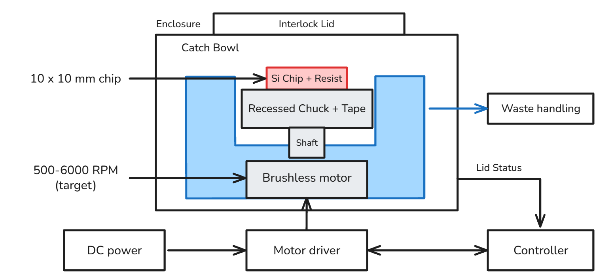
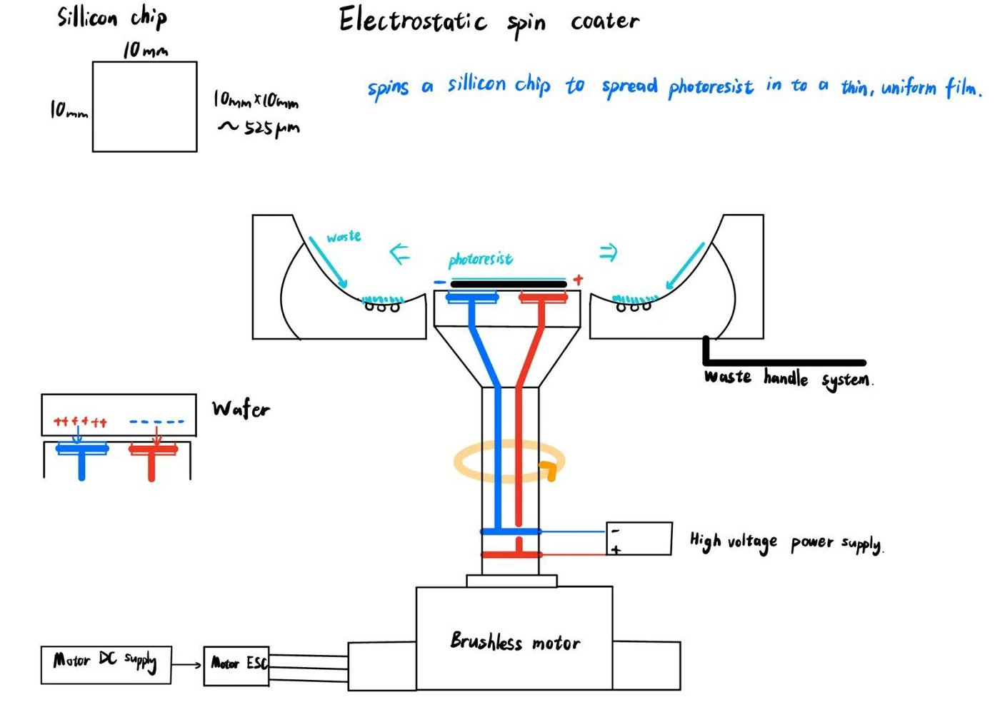

# Spinner
The spinner will be used to coat 10 × 10 mm silicon chips with a thin, uniform layer of photoresist or spin-on dopant at a controlled speed (500–6000 RPM). It is designed in CAD and not yet built or tested.

**Spinner BOM**

| Item | Qty | Unit Price | Line Total |
|---|---:|---:|---:|
| [SunnySky X2216 1250KV Brushless Motor](https://sunnyskyusa.com/products/sunnysky-x2216-brushless-motors) | 1 | $18.99 | $18.99 |
| Holybro Tekko32 F4 45A ESC (AM32) | 1 | $23.99 | $23.99 |
| [Mean Well GST60A12 12 V 5 A Power Supply](https://www.jameco.com/z/GST60A12-P1J-MEAN-WELL-12VDC-5A-60W-3-Wire-Desktop-Power-Adapter-with-2-1mm-Plug_2224382.html) | 1 | $19.40 | $19.40 |
| Import tariff on power supply (21%) | 1 | $4.07 | $4.07 |
| Pololu D24V10F5 5 V Regulator | 1 | $13.95 | $13.95 |
| Omron SS-5GL Lid Interlock Switch | 1 | $2.09 | $2.09 |
| 2.1 mm DC Jack to Screw Terminal | 1 | $2.00 | $2.00 |
| **Total Build Price** | | | **$84.49** |

Already on hand (no cost): ESP32-S3 dev board, PLA for printed parts (about 350 g, Anderson Labs), Ø93 × 3 mm polycarbonate lid, double-sided Kapton tape, M3 screws and wire. Not included: power switch, shipping, tax. Prices checked 11/1/26; nothing ordered yet.

## Chuck
The chip sits in a 10.3 mm recessed pocket on a printed PLA chuck (Ø40 mm) and is held down with double-sided Kapton tape. The pocket takes the sideways force when spinning; the tape keeps the chip from lifting. The pocket size will be chosen by printing a test coupon with 5 pocket sizes (10.2, 10.3 and 10.4 mm at 0.45 mm deep; 10.3 mm at 0.30 and 0.60 mm deep).

## Motor & Drive
The chuck screws onto the rotor of a SunnySky X2216 1250KV brushless motor, driven by a Holybro Tekko32 ESC running open-source AM32 firmware. The ESC reports the actual RPM over a serial telemetry wire, so no separate tachometer is needed. The motor mounting holes (assumed 16 × 19 mm) will be measured when it arrives.

## Controller

An ESP32-S3 runs a PID speed loop: it sends DShot300 speed commands to the ESC and reads RPM back from the telemetry wire. A recipe runs 300 RPM start, 1500 RPM/s ramp, 5–180 s hold, then a controlled ramp down, the same profile as the [CMU Hacker Fab spin coater](https://docs.hackerfab.org/home/fab-toolkit/spincoater). Recipes are set and RPM is logged from a laptop over USB serial. Opening the lid triggers a slow stop instead of a hard brake.

| Signal | From | To | Notes |
|---|---|---|---|
| Speed command (DShot300) | ESP32-S3 GPIO | ESC signal pad | Pin to be assigned |
| RPM telemetry (UART, 115200 8N1) | ESC TX pad | ESP32-S3 GPIO | Check 3.3 V level with a scope first |
| Lid interlock | Omron SS-5GL | ESP32-S3 GPIO to GND | Open lid = stop |
| USB serial | ESP32-S3 USB | Laptop | Recipes in, RPM log out |

## Enclosure & Catch Bowl
A printed base (150 × 150 × 45 mm) holds the motor and electronics. Three posts hold a catch bowl (Ø95.5 × 34 mm) around the chuck, with the chip top 8.8 mm below the bowl rim. A clear polycarbonate lid presses the interlock switch when closed. Overall size with lid: 150 × 150 × 102 mm.

## Electrostatic Chuck (future)

An electrostatic chuck is designed and calculated as a later upgrade. It needs lab safety approval for high voltage before any testing.
