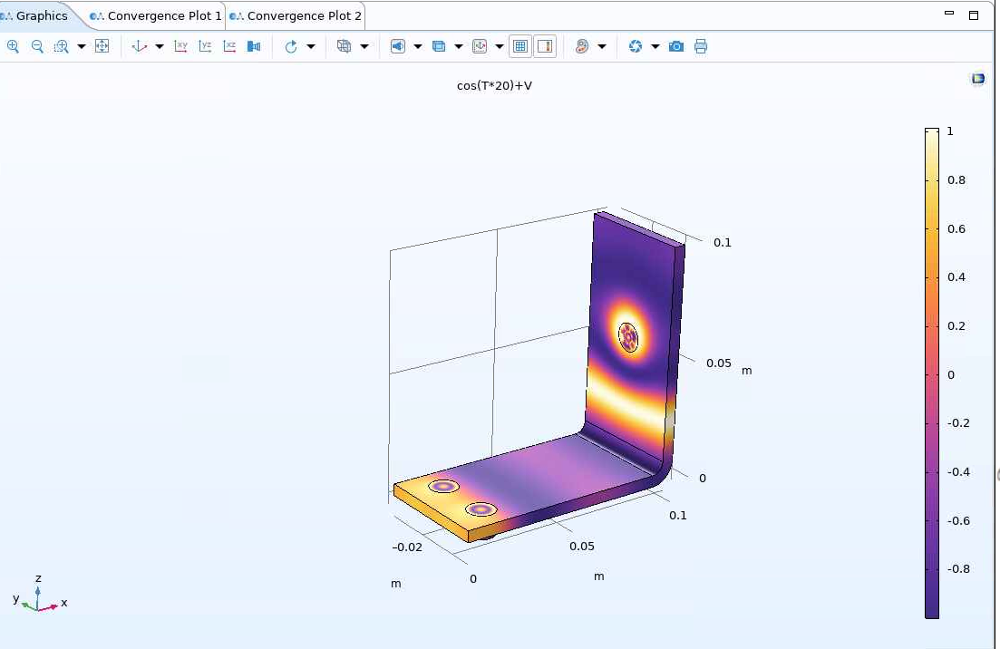

# Weekly Update #1 (11/15/26)

*By Bear BlinSchauer*

I am building a DC magnetron and sputtering system. The goal is to design and finish assembling this system by the end of this year. The overall goal of UMNTC hacker fab is to create working mosfets by the end of this year. The sputterer is one of the key machines we are beginning our work with.

Here at UMNTC hacker fab, we are starting to log weekly work to complement our
documentation. Anyone is free to read along this blog to track our progress!

Currently in the project, we are starting our magnetron design from a design by
advanced tinkering. This week I worked more on the CAD design for the sputtering cathode.

In order to better understand how the physical parts would fit together and the
approximate size of the system, I printed out the sputter head this week on my
printer at home. Professor Cho is advising the fab project and suggested that
the magnetron head was quite large, so we will work in order to minimize this size.

We are using COMSOL to simulate parts of our project, so this week Im working on learning comsol, below are some plots of simulations which I was
working on. COMSOL has a lot of buttons, but the documentation on creating
simulations has been straightforward so far.

Previously we had planned to use PEEK as our insulator, but are reconsidering
due to the worry that it will melt, and outgassing. Running simulations will get a good sense of
if the thermal conductivity of our cathode is good enough that it overcomes the
glass transition temperature of peek at the interface.

## Timeline to Finish (Goal: Fri 3/5/27)

Originally we had planned to have the sputterer done by the end of the semester.
The current progress pace has given some feedback on this goal, so I decided to stretch the timeline to the
start of May. The main goal of our fab overall is that by the end of the school year we will have
working MOSFETS. Ideally we want the sputterer to be one of the first machines
to finish development. If we are able to change our pace, I will shrink the
timeline down again. The sputterer is one of our priority machines.

Everything is this timeline is due Friday of that week.

- **Week of 11/16 (due 11/20): purchasing first**
  - Source long-lead items in BOM, and get quotes for missing items: pumps, gauges, PSU each have a price quote + lead time
  - Beggin Submitting purchase / funding requests for immobile design items: request for pumps, gauges, chamber and PSU.
- **Week of 11/23 (due 11/25): place orders**
  - Ordering long-lead parts as soon as funding is approved: pumps, gauges, PSU, cube chamber; **long-lead parts ordered**
  - Order & Ship Al target, BOM
  - Shrink magnetron CAD to v2 based on Cho's recommendation and review: v2 head is smaller than the v1 print, fixes short comings with original design. Then re-3dprinted to check the fit
- **Week of 11/30 (due 12/4)**
  - COMSOL sim of v2 magnets orientations
  - Order magnets to match the sim: **all parts should be ordered**
  - Add water cooling system parts to assembly + dark space shield to CAD.
- **Week of 12/7 (due 12/11)**
  - Final Design Reviews from advisors feedback ; **Freezing CAD**
  - Machining drawings for magnetron parts: PDF drawing for every machined part, dims + tolerances
  - Machine Basic elements, assemble chamber, pre-magnetron machined.
- **Week of 12/14: finals (due 12/18)**
  - (Hopefully) Receive + inspect deliveries: parts checked against BOM; anything missing or damaged logged; **parts in hand**
- **Week of 12/21: off**
  - Winter break, buffer for late shipments. Resize timeline during this period
  based on pace.
- **Week of 12/28 (due 1/1)**
  - Bench-test pumps on blank flange: scroll + turbo run. Logging and recording
  the pump-down.
- **Week of 1/4 (due 1/8)**
  - Wiring + interlock diagram: PSU, pumps, gauges, HV interlock
  - Write safety SOP: 1-page Safety / HV / implosion / startup / shutdown checklist
- **Week of 1/11 (due 1/15)**
  - Machine magnetron parts: Deadline for all parts to be machined matching drawings.
- **Week of 1/18 (due 1/22)**
  - Assemble magnetron + test: no water leaks at full flow; gaussmeter readings which match COMSOL simulations
- **Week of 1/25 (due 1/29)**
  - Assemble chamber + magnetron
- **Week of 2/1 (due 2/5)**
  - Pump down + leak check
- **Week of 2/8 (due 2/12)**
  - Install magnetron, Argon line, PSU wiring, Ar flow control system. Wire PSU through the interlock
- **Week of 2/15 (due 2/19)**
  - Safety check with advisor + **first plasma**: SOP signed off. Create stable plasma at a few mTorr Ar
- **Week of 2/22 (due 2/26)**
  - Attempt first Al deposition. This will be a Al film on a glass slide. Measuring conductivity and film thickness.
- **Week of 3/1 (due 3/5)**
  - Buffer, fixes, finalize docs. Demo deposition shown to entire club. **Finished!**

After this, the main goal will be to improve the design, integrate it with the
process, and add the RF pow supply for dialectric deposition.

**Some Big Milestones:** long-lead parts ordered 11/25 · all parts ordered 12/4 · CAD frozen 12/11 · parts in hand 12/18 · chamber at base pressure 2/5 · first plasma 2/19 · **finished 3/5**
