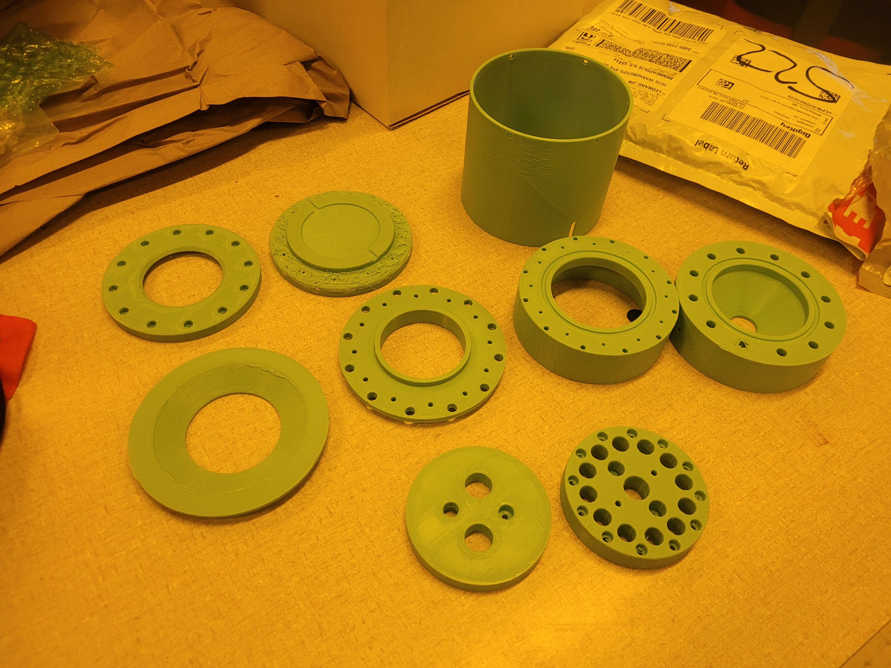
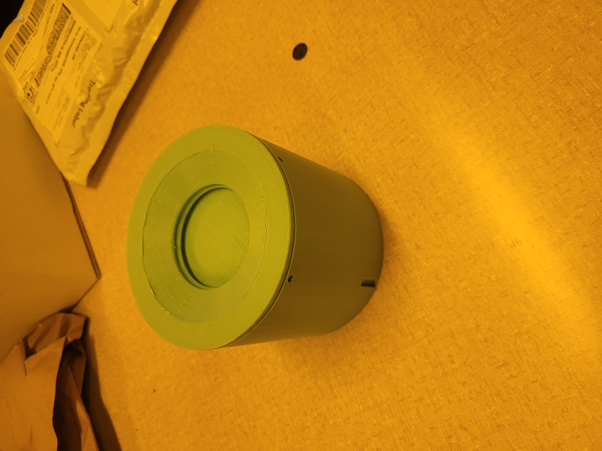
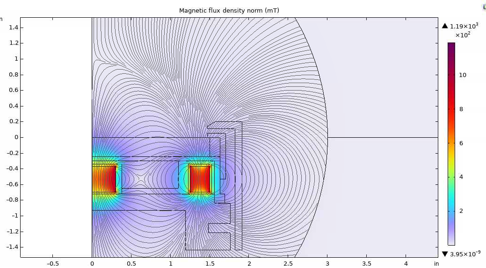

# Weekly Update #1 (11/15/26)

*By Bear BlinSchauer*

I am building a DC magnetron and sputtering system. The goal is to design and finish assembling this system by the year.

This week I worked more on the CAD design for the sputtering cathode. 

In order to better understand how the physical parts would fit together and the
approximate size of the system, I printed out the sputter head this week on my
printer at home. Professor cho suggested that the magnetron head was quite
large, so we will work in order to minimize this size. 

Im working on learning comsol, below are some plots of simulations which I was
working on.

