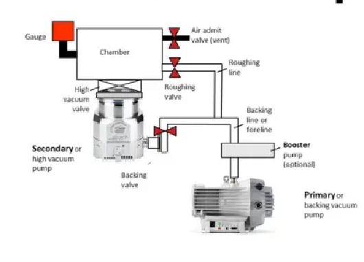
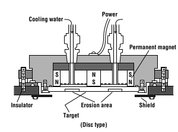
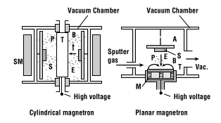
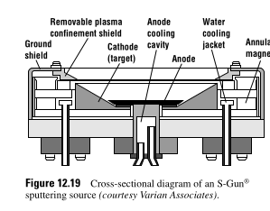

# Build

<!-- gdoc-sync:begin main-outline/design-drawings | generated from the Google Doc: edit the doc, not this block -->
## Design Drawings

[https\://link.excalidraw.com/l/3pV8fsMMqar/2rMCtyBjeuD](https://link.excalidraw.com/l/3pV8fsMMqar/2rMCtyBjeuD)  
[https\://app.excalidraw.com/l/3pV8fsMMqar/8ygDm5HuHUY](https://app.excalidraw.com/l/3pV8fsMMqar/8ygDm5HuHUY)
<!-- gdoc-sync:end main-outline/design-drawings -->

<!-- gdoc-sync:begin main-outline/bill-of-materials | generated from the Google Doc: edit the doc, not this block -->
## Bill Of Materials

Estimated cost via hacker fab design \$18,356.91-\$7,811.94  
[Bill of Materials](https://docs.google.com/spreadsheets/d/1QDfNqg_ETuOKC6wyeLsdElsUQSRcteqAhrti9fjViLY/edit?gid=0#gid=0)
<!-- gdoc-sync:end main-outline/bill-of-materials -->

<!-- gdoc-sync:begin design-modifications | generated from the Google Doc: edit the doc, not this block -->
## Design Modifications

* Remove baffle  
* Remove baffle cooling system  
* Add dedicated line for argon plumbing  
* Add Ion gauge  
* Net around the bell jar. (Recommended by brian.)  
* Idealvac design suggestions.   
* Remove the thermal evaporator.  
* Modify sputterer to work with RF power. 
<!-- gdoc-sync:end design-modifications -->

<!-- gdoc-sync:begin miscellaneous-docsnotes | generated from the Google Doc: edit the doc, not this block -->
## Miscellaneous Docs/Notes

Outgassing is a design issue with the sputterer and will make constructing it harder.

Plastics cannot be used, Brass cannot be used because the zinc will evaporate away from it. 

Viton will be used as a gasket material. Need to figure out if there is a place we can laser cut this. 

A mass flow controller, used for inserting gases into the chamber. Can use indicator ball. Digital MFC more accurate. 

An argon flush is useful before processing in order to remove and suck out contaminants before processing. The chamber can also be cleaned with acetone first as well.

Start with the shutter closed, until the plasma is stabilized.

Implosions are a safety concern, especially when modifying the glass.

Thermal evaporator \-\> high current,  
Sputterer \-\> high voltage.  
Either high voltage or high current can be made with microwave oven transformers. Transformers are dangerous, treat them with respect.

The sputter gun needs to be cooled. Otherwise wit will cause issues such as de-magnetizing the magnetron magnets, or damaging the target.  
  
  

S gun, a sputter design trademarked by varian.   

<!-- gdoc-sync:end miscellaneous-docsnotes -->
