# DC & RF Power

## Controls & Instrumentation

<!-- gdoc-sync:begin power-draw-writeup | generated from the Google Doc: edit the doc, not this block -->
## Power Draw Writeup

### Theory

#### Creating a plasma

Plasma is created by creating a voltage across a gap with a low pressure gas.   
The required breakdown voltage is determined by the following equation (Paschens law). Importantly, this is the voltage required to start plasma, not maintain it. Freeing electrons will cause a chain reaction which lowers the voltage needed to hold a plasma.

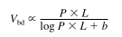

*  P: Chamber pressure  
* L: electrode spacing  
* b: some constant (unspecified by campbell is actually ln(ln(1+1/gamma\_se)) where gamma se is the secondary electron emission coefficient of the cathode surface under ion bombardment, typically 0.05-0.15)

#### Sputter efficiency

When a plasma is formed, a couple of outputs may happen at the surface of the target

* The incident ion bounces off  
* The incident ion frees electrons from the target  
* The incident ion sputters atoms away from the target  
* The incident ion is implanted into the target

Unwanted ion implantation throttles sputtering. This only happens in the range of several keV.  
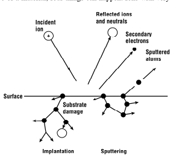

---

“The sputter deposition rate depends on the  
ion flux to the target, the probability that the  
impact of an incident ion will eject a target  
atom, and the transport of the sputtered  
material across the plasma to the substrate.”

- Campbell

One of the variables, the ion flux uses the Langmuir-Child” relationship, below:  
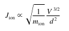  
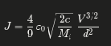

* **V:** Voltage difference target electrode to wafer  
* **d:** dark space thickness  
* **m:** Ion mass  
* **J:** Ion current density

---

Sputter Yield:  
S=(\#ions incident target)/(ions ejected from target)

Sputter yield depends on ion mass, ion energy, target mass and target crystallinity.   
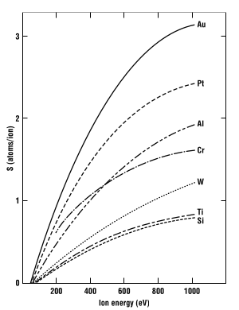  
For Sputtering, there is a lower energy threshold. If the ions are below that energy, no sputtering occurs.  

---

For some materials, the angle between the target normal and ion velocity has an extreme effect on the sputter yield.  
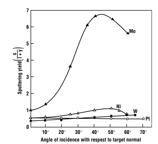  
The orientation of of the magnets can change theta a lot.   
---

The sputter current voltage curve below is an example of sputter magnetron performance.  
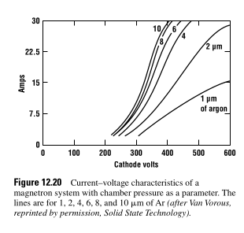  
The curves are of the following form  
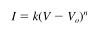

* Vo: minimum voltage required to maintain plasma  
* n: Positive number between 1.5 and 8 which depends on the target geometry and chamber pressure.	

### Calculations

The three highest power consumers are the following:

1. Pfeiffer Vacuum HiScroll 6 (480W, 4A@120VAC or 2A@240VAC)  
2. Pfeiffer HiPace 80 Neo Turbopump (110W, 24VDC 5A recommended to use 200watt DC power supply, the Pfeiffer OmniControl 200 controller)  
3. DC Sputter power supply (Information below)

**Practical Upper Bound:**  
The realistic upper bound mainly has to do with the maximum amount of power our power supply can provide regardless of what is needed to maintain plasma. Modern power supplies will not readily supply more power than they are rated for, and will go into CC mode if you use too much current.

To power the sputterer we are going to use either the Advanced Energy RFX-600RF power Generator, or a surplus power generator online such as the Advanced Energy MDX-500 class DC supply.

RFX-600RF \-\> 600W  
*Could not find fine tuned electrical specs table for the RFX*

MDX-500 \-\> 500W  
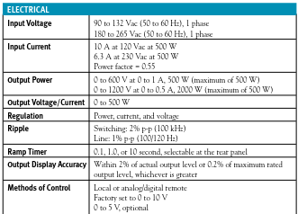

**Theoretical Normal operating mode:**

Most likely, the power supply we have will have a lower voltage, so it's reasonable to start narrowing down variables with the plasma strike.  
Recall Paschens law. (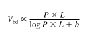). If using the MDX-500, The maximum voltage is around 600V, we will do calculations at 550V to add room for power supply failure. By using algebra to solve, the most practical pressure is below (?) 

Strike values for 500V and d=5mm are typical of a magnetron design using a few millitor (Where do these values come from?). The Child Langmuir Law can predict the deposition rate density.  
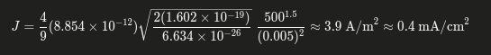  
This model severely underpredicts the deposition rate because it only works when there is no B field trapping electrons, the practical magnetron sputter rate may be an order of magnitude higher as extra electrons increase sputter yield.

By using P=IV and the CV characteristic equation:  
**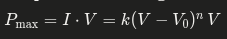**  
Based on the following CV model, gas pressure, voltage, and magnetron geometry are the main driving factors to current draw.  
The CV curve is non linear, the current draw sharply increases after around 4-6 millitorr in the chamber.

### Power safety

Many DIY DC supplies rely on using a variac, microwave oven transformer and bridge rectifier to achieve the correct power. Doing this is pretty dangerous if you are not trained and careful. Building a custom power supply has advantages in flexibility, may need consultation to make sure the circuit is properly isolated and check against facilities owners when doing this.

We are hoping to use a surplus power supply designed for sputtering, supplying 500-600V max.

Still need to resolve high voltage safety standard operation and training for club members working on this project. 

### Source List

Stephen Campbell- Fabrication engineering at the micro and nano scale ch 12 ch 10\.

[https\://calculator.academy/paschens-law-calculator/](https://calculator.academy/paschens-law-calculator/)

Magnetron \- A device which generates a high power electromagnetic wave. Used in microwaves

Variac \- A special type of transformer that can have variable voltage output. 

Outgassing \- Gas escaping from materials from inside a vacuum, thus reducing the vacuum and adding contaminants to the chamber.  

<!-- gdoc-sync:end power-draw-writeup -->
