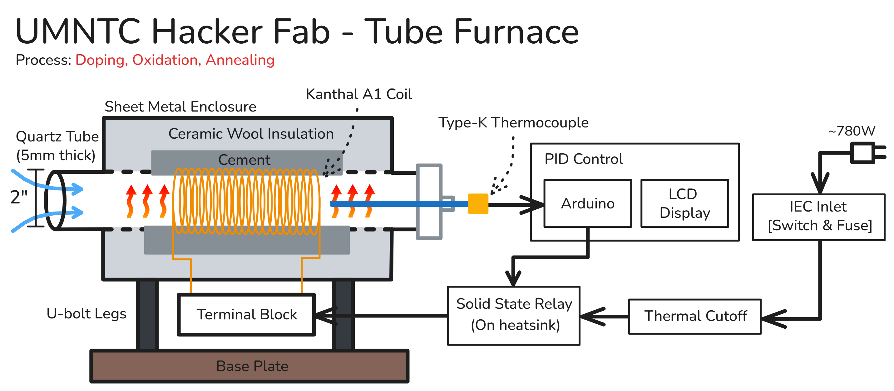

# Tube Furnace
The tube furnace will be used for thermal oxidation, dopant diffusion, and annealing. The tube furnace will achieve a temperature of 1100C in 15-20mins at 780W. For the first version of the tube furnace oxide will grow in ambient air with the tube furnace ends open. A water vapor oxidation and vacuum pump down process for faster oxidation is currently being designed.   

**Tube Furnace BOM**

| Item | Specification | Qty | Unit Price | Line Total |
|---|---|---:|---:|---:|
| [Quartz Tube](https://www.sentrotech.com/quartz-ware-2/) | 2" outer diameter × 5 mm wall × 9.5" long | 1 | $55.00 | $55.00 |
| [Ceramic Wool Blanket](https://ssfbs.com/product/durablanket-8-lb-density-1-x-24/) | 1" × 24" × 25 ft roll, 2400 °F, 8 lb density | 1 | $137.50 | $137.50 |
| [Kanthal A1 Wire](https://www.amazon.com/dp/B095QN5ZXG) | 22 AWG, 100 ft | 1 | $13.30 | $13.30 |
| [Refractory Cement](https://www.amazon.com/dp/B0C2KDBRBN) | 5 lb, 3000 °F | 1 | $26.99 | $26.99 |
| [Ceramic Wire Sleeve](https://www.mcmaster.com/products/wire-insulation/no-irritation-ceramic-high-temperature-wire-sleeving) | ~1/8" ID, 3 ft (min sizing) | 1 | $5.34 | $5.34 |
| [Steel Sheet](https://www.mcmaster.com/6544K232/) | 0.001" thickness | 1 | $23.65 | $23.65 |
| [Legs](https://www.amazon.com/dp/B0B7N7MVJ3) | Screw into a base, hold up the furnace shell | 1 | $10.97 | $10.97 |
| [Sheet Metal](https://www.amazon.com/dp/B0FQV33FS7) | Scrap sheet metal | 1 | $9.99 | $9.99 |
| [IEC Inlet Module](https://www.mcmaster.com/5428N14/) | 10–15 A 250 V, integrated switch + 5×20 mm fuse holder | 1 | $29.34 | $29.34 |
| [IEC Power Cord](https://www.amazon.com/dp/B08GL639TD) | C13-to-NEMA 5-15P, standard PC power cord | 1 | $8.73 | $8.73 |
| [Spare Fuse](https://www.mcmaster.com/6978K758/) | 5×20 mm, 10 A slow-blow, pack of 5 | 1 | $4.99 | $4.99 |
| [Independent Thermal Cutoff](https://www.amazon.com/dp/B0FSPRKJQY) | ≈240 °C, non-resettable | 1 | $34.95 | $34.95 |
| [Solid-State Relay](https://www.mouser.com/ProductDetail/Crydom/D2425) | Zero-cross, DC input, terminals 1/2 load, terminals 3/4 control | 1 | $60.71 | $60.71 |
| [Solid-State Relay Heatsink](https://www.mouser.com/ProductDetail/Crydom/HS301DR) | For 25 A relays, roughly 80 × 50 × 50 mm | 1 | $42.57 | $42.57 |
| [Thermal Paste](https://www.amazon.com/dp/B07Q6KDP9K) | Silicone-based, non-curing, metal-oxide filled | 1 | $15.20 | $15.20 |
| [Ceramic Terminal Block](https://www.amazon.com/dp/B09KGQJNRR) | 2-way porcelain, ≥25 A | 1 | $6.89 | $6.89 |
| [PTFE Hookup Wire](https://www.amazon.com/dp/B08DCYLDF4) | 18 AWG, several colors, cold-zone run | 1 | $20.99 | $20.99 |
| [Cable Glands](https://www.amazon.com/dp/B0FJFVBLJD) | 2–3 pcs, for lead and thermocouple entry | 1 | $8.29 | $8.29 |
| [Sheet Metal Screws](https://www.amazon.com/dp/B0F9415MYD) | #6–#8, 20 pcs | 1 | $5.98 | $5.98 |
| [Heat Shrink Tape](https://www.amazon.com/dp/B01MFA3OFA) | Assorted sizes | 1 | $7.99 | $7.99 |
| [Ring/Spade Terminals](https://www.amazon.com/dp/B00NVD3FE6) | Assorted sizes, every hot-leg joint | 1 | $10.00 | $10.00 |
| [Wire Nuts](https://www.amazon.com/dp/B0G2S21315) | For any non-terminal-block splices | 1 | $4.99 | $4.99 |
| [Electrical Tape](https://www.amazon.com/dp/B001AXD0EY) | General purpose | 1 | $3.28 | $3.28 |
| [Arduino Uno Rev3](https://store-usa.arduino.cc/products/arduino-uno-rev3) | Arduino for the PID controller | 1 | $27.60 | $27.60 |
| [Thermocouple](https://www.mcmaster.com/product/3859K44) | 6", ceramic sheath, ≥1100 °C rated | 1 | $10.00 | $10.00 |
| [LCD Display](https://www.amazon.com/dp/B0BWTFN9WF) | Display for the Arduino PID controller | 1 | $12.99 | $12.99 |
| **Total Build Price** | | | | **$598.23** |
