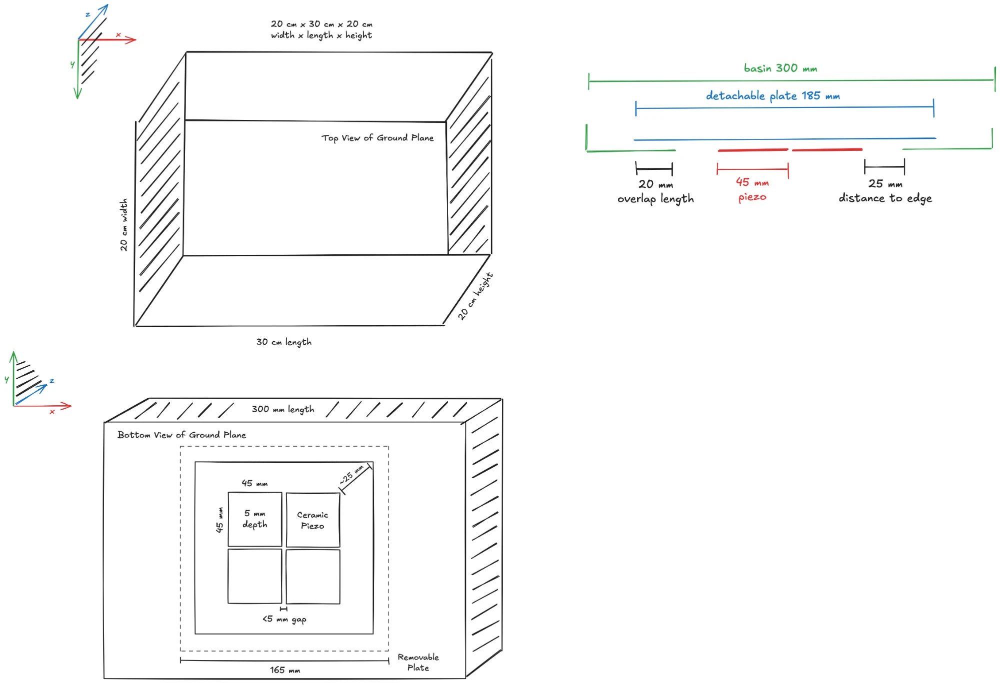
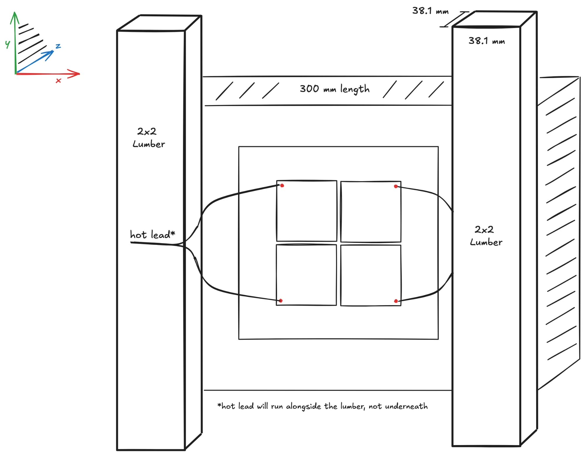
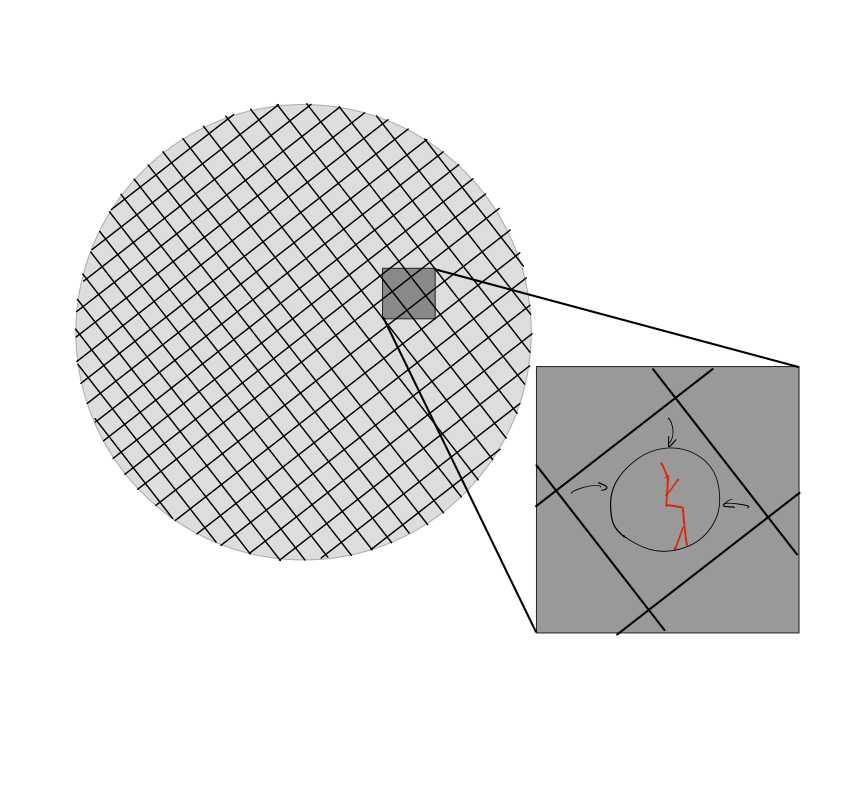
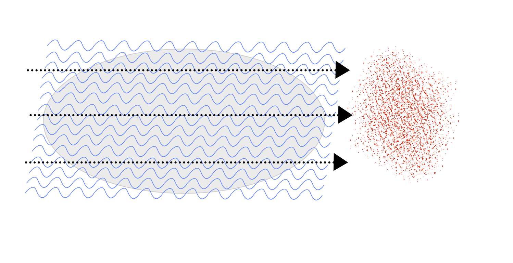

# Ultrasonic Cleaner

Lead: [Hadi Ahmad](#/updates/hadi-ahmad)

A high-frequency (~420 kHz) ultrasonic cleaner that removes dust and residue from wafers between process steps. Four ceramic piezo plates bonded under a water tank are driven by an STM32 and a MOSFET full bridge.

*Note: the measurements in these sketches differ from the v1 design.*

## How it works

**Problem:** dust and residue land on wafers between every step. One particle can kill a chip, and with our 2 µm feature target on 100 mm silicon wafers, even ~1 µm particles matter.

**Solution:** piezo plates bonded to the water tank vibrate at ~420 kHz. The sound waves knock particles off the wafer surface.

**Why ~420 kHz?** Typical 40 kHz cleaners make large bubbles. The rapid pressure change vaporizes the water instantly, and when the bubble implodes on the rebound it can damage features.

Above 400 kHz the bubbles are smaller, and acoustic streaming picks up ~1 µm particles. Think of driving at 70 mph: the dust on your hood stays put, because the air right at the surface barely moves. That thin still layer is the boundary layer, and small dust hides inside it. A higher frequency makes the still layer thinner, so the flow reaches down to ~1 µm particles.

Industry uses ~1 MHz. ~420 kHz is an affordable first step.

## Progress

Done:
- Signal chain designed
- Power stage schematic (KiCad)
- SPICE simulation: 64% → 95% simulated efficiency
- BOM and Timeline

Upcoming: bond the piezos, build the circuit on protoboard, first test run.

Planned feedback system:
- Resonance tuning: phase tracking with a PLL
- Temperature: thermistors, thermal imager
- Fault protection: dry-tank shutoff, current limiting

Future goals: Marangoni drying (an alternative to spin drying) and megasonic frequency.

## Timeline

Updated 11/17/26.

Ordering depends on funding. The Envision Fund application is temporarily closed; I'm working on it.

Goal: a proof-of-concept cleaner with four bonded piezo plates running at ~180 W, with cleaning shown on a test sample, by early July 2027.

| Phase | Dates |
|---|---|
| Paper design: schematic, simulation, mechanical layout, BOM | 11/17 – 12/5 |
| Order parts once funded (piezo plates first, they have the longest lead time) | by 12/5 |
| Bench test the bridge into a resistor; practice bonds on dummy plates | 12/5 – 12/17 |
| Out of town (Winter Break) | 12/18 – 1/18 |
| Measure and bond at least one plate | 1/19 – 2/6 |
| Power stage: bridge delivers ~50 W into a resistor | 1/19 – 2/13 |
| Measurement and feedback setup: resonance, power efficiency, temperature | 2/8 – 2/19 |
| First sound in water: one plate at 40+ W for 10+ min | 2/20 – 3/19 |
| Tentative: measure and bond other three plates, if not done already. | 3/19 – 3/27 |
| Full power: four plates at ~180 W for 30 min | 3/28 – 4/16 |
| Buffer and write-up | 4/17 – 6/25 |
| Control, protection and PCB | 4/19 – 5/28 |
| Process Integration | 5/31 – 6/25 |

**Ultrasonic Cleaner BOM (V1)**

Full parts list with links: [BOM spreadsheet](https://docs.google.com/spreadsheets/d/1lPzEHpcH_-OY_zxeZMZM0a9sHuuc5Ie2QJlFZps3Eoo/edit?usp=sharing)

| Group | Main parts | Cost |
|---|---|---:|
| Basin | Stainless steel table pan, structural epoxy | $44.65 |
| Piezo | 4 ceramic plates (+2 spares), silver conductive epoxy | $194.90 |
| Electronics | STM32G474RE, 2× IR2110, 4 MOSFETs | $36.56 |
| Magnetics | ETD29 transformer and inductor cores, Litz wire, heat sinks | $134.94 |
| Tools | Temperature probe | $6.90 |
| **Total** | | **$417.95** |
