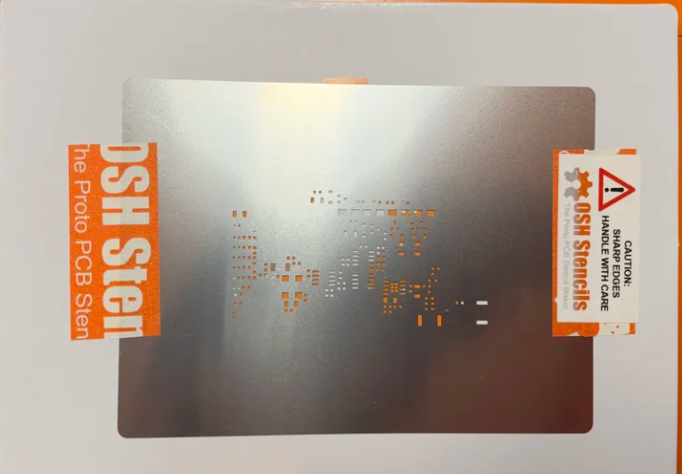
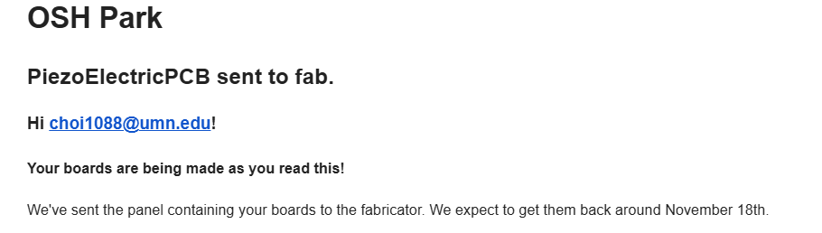

# Andrew Choi

I am building the Inkjet Microplotter and I am also the Gen 2 Fab lead.

## Weekly Update #1 (11/17/2026)

The Stencil for the pcb that will be operating piezo electric has arrived but I am still waiting on the pcb and all the smd components to arrive from digikey and oshapark.

The pcb is projected to arrive by this week so I can get started on soldering whenever the smd components arrive.
I have started working on the documentation for the whole project and want to get it done this week since I have more time this week.
The timeline also will be finished by this Thursday and ready for Prof.Cho's meeting.
