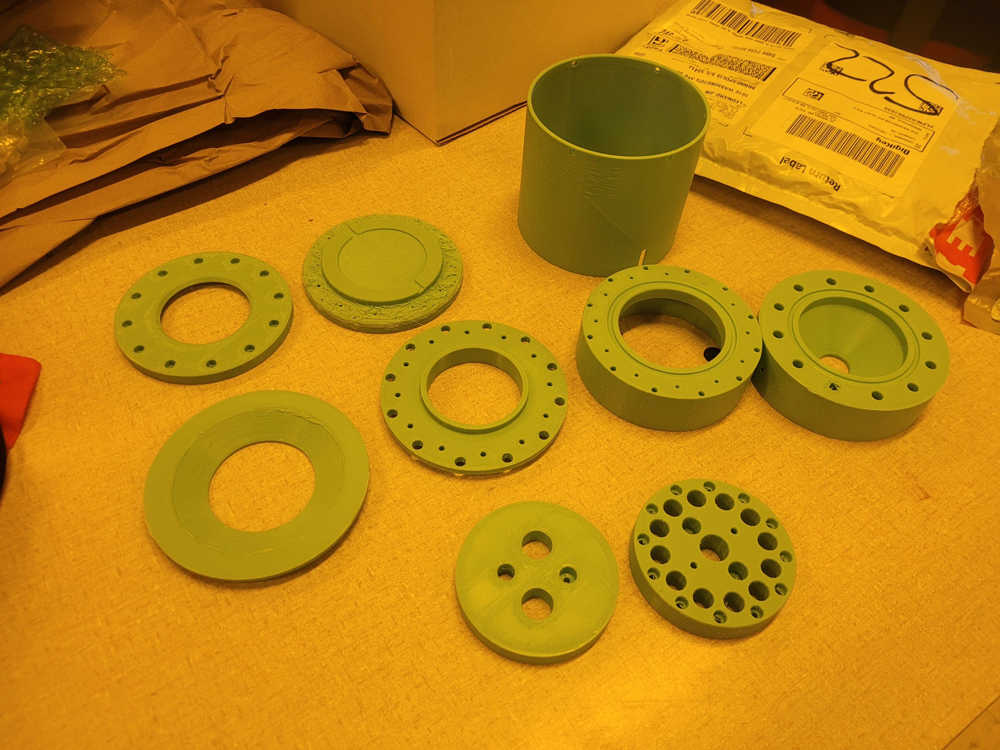
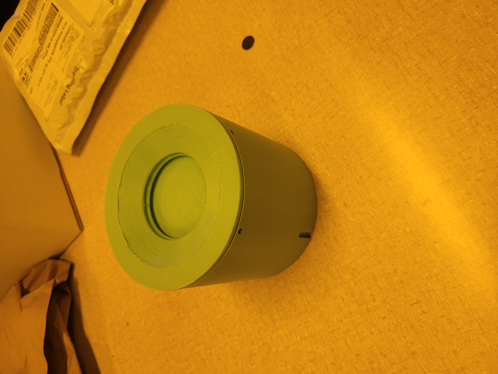
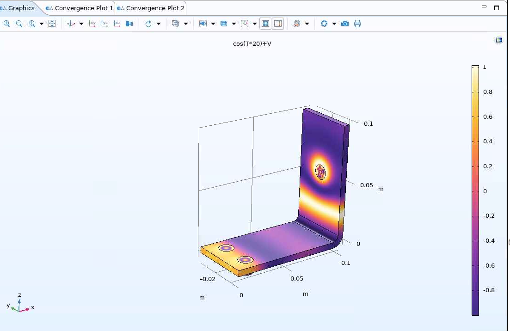
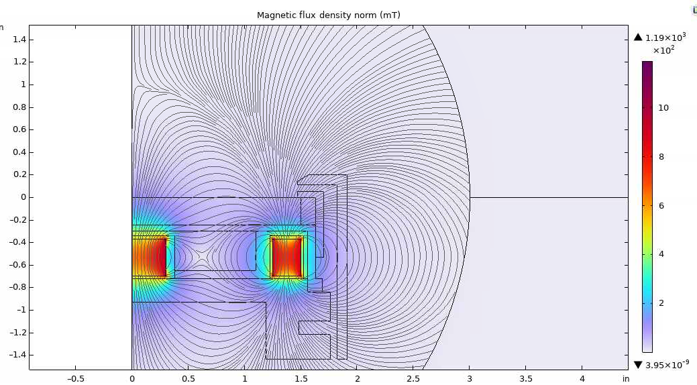

# Bear BlinSchauer
I'm building the [DC & RF Magnetron Sputterer](#/gen-one/sputterer). Below are my weekly updates.

## Weekly Update #1 (11/15/26)

I am building a DC magnetron and sputtering system. The goal is to design and finish assembling this system by the end of this year. The overall goal of UMNTC hacker fab is to create working mosfets by the end of this year. The sputterer is one of the key machines we are beginning our work with.

Here at UMNTC hacker fab, we are starting to log weekly work to complement our
documentation. Anyone is free to read along this blog to track our progress!

Currently in the project, we are starting our magnetron design from a design by
advanced tinkering. This week I worked more on the CAD design for the sputtering cathode.

In order to better understand how the physical parts would fit together and the
approximate size of the system, I printed out the sputter head this week on my
printer at home. Professor Cho is advising the fab project and suggested that
the magnetron head was quite large, so we will work in order to minimize this size.

We are using COMSOL to simulate parts of our project, so this week Im working on learning comsol, below are some plots of simulations which I was
working on. COMSOL has a lot of buttons, but the documentation on creating
simulations has been straightforward so far.

Previously we had planned to use PEEK as our insulator, but are reconsidering
due to the worry that it will melt, and outgassing. Running simulations will get a good sense of
if the thermal conductivity of our cathode is good enough that it overcomes the
glass transition temperature of peek at the interface.
