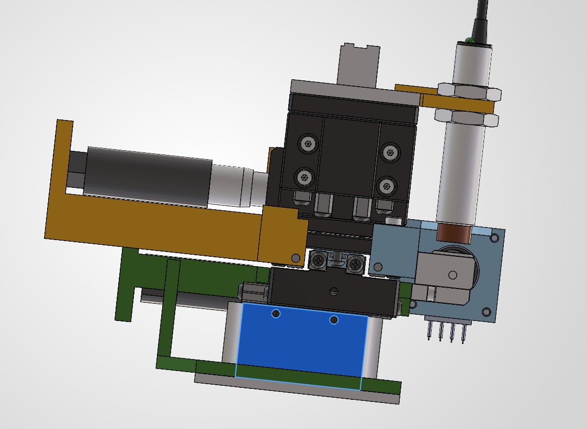

# Example Member

My name is Bob and I will be working on building a DMD chipset.

## Weekly Update #2 (11/9/26)

I was able to complete all the GitHub project tracker tasks I set out to do last week as well as talk to the lab automation team to figure out what they need from us on the database.

## Weekly Update #1 (month/day/year)

I did some preliminary research, you can find the task for this in GitHub project tracker here: xxx. I drew some schematics for the Database, which can be found in the master doc here: xxx. I am facing the challenge of IV curves appearing to be limited by power so I am reaching out on the Digilent forum. My plans for next week are to do these GitHub project tracker tasks:
