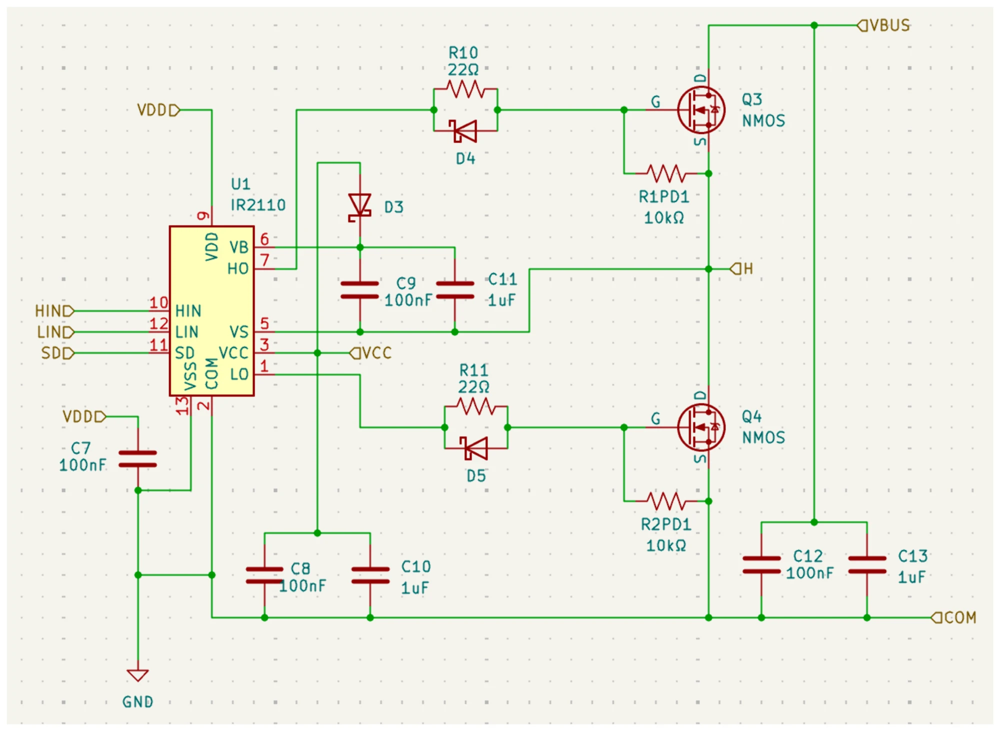
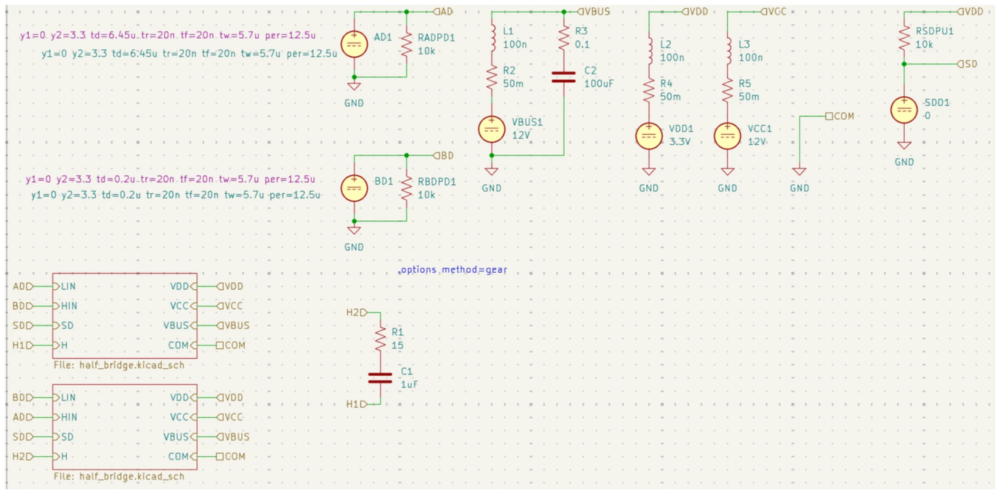
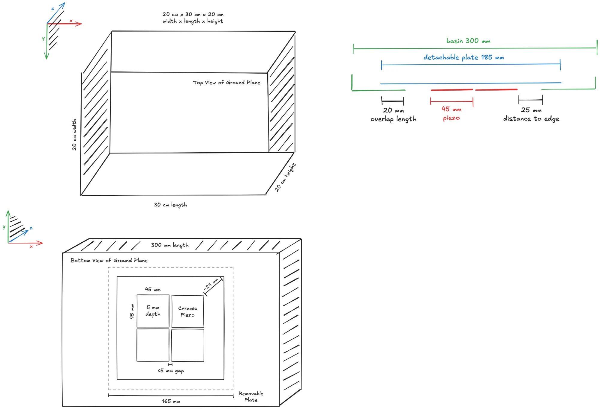
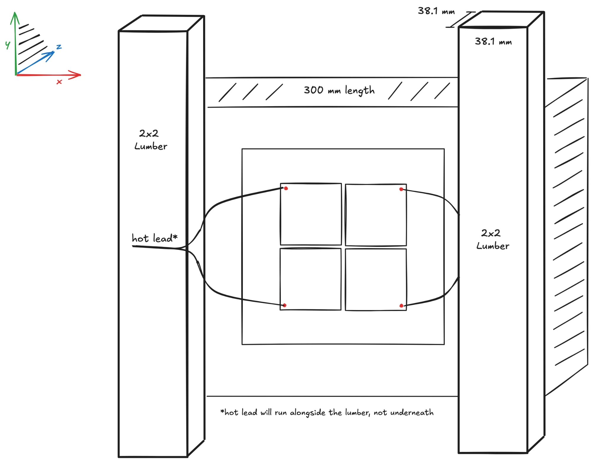
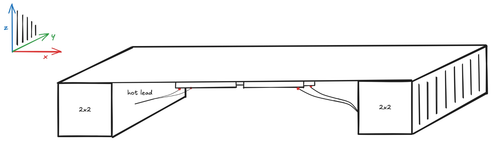
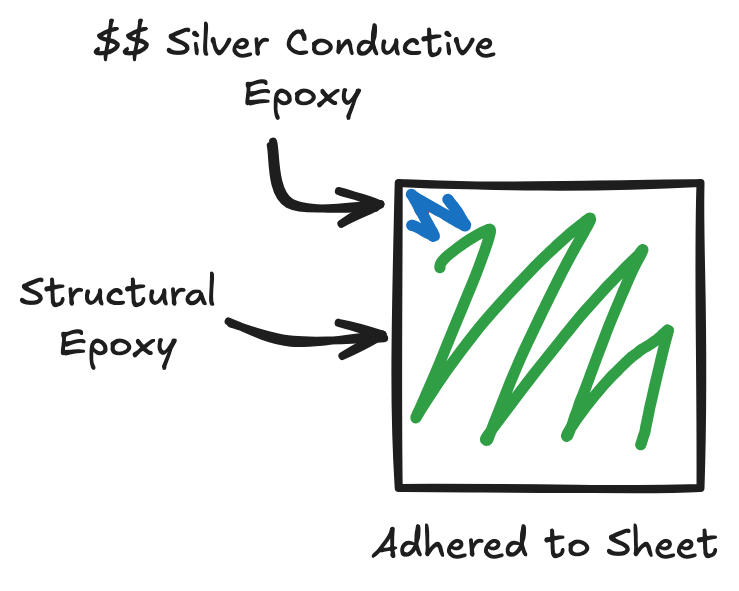

# Hadi Ahmad
I'm building the [ultrasonic cleaner](#/gen-two/ultrasonic-cleaner). Below are my weekly updates and ultrasonic cleaner information.

## Information
**Tank**: stainless steel table pan, 325 × 265 × 200 mm \
**Power**: ~180 W from the piezo transducers (rough estimate) \
**Driver**: Nucleo-64 STM32G474RE + 2× IR2110PBF gate drivers, full bridge (two half bridges) \
**Transducers**: 4× 45 × 45 × 5 mm ceramic piezo plates on a removable plate under the tank

## Weekly Update #1 (11/17/26)
- Full-bridge driver schematic (two half bridges) drafted in KiCad, with a simulation page that drives a model of the transducer (64% → 95% simulated efficiency).
- Tank, piezo layout and mounting sketched. Plates are bonded with structural epoxy, with silver conductive epoxy for the electrical contact.
- [BOM V1](https://docs.google.com/spreadsheets/d/1lPzEHpcH_-OY_zxeZMZM0a9sHuuc5Ie2QJlFZps3Eoo/edit?usp=sharing) done: $417.95 for the planned parts.
- Next: order parts once funded. The Envision Fund application is temporarily closed; I'm working on it.

*Note: the measurements in these sketches differ from the v1 design.*
