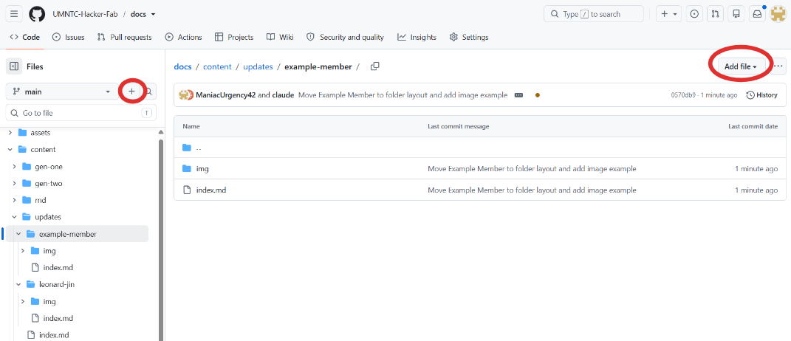
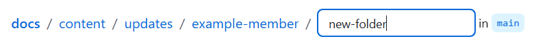

# Updates

```cards
Example Member | | #/updates/example-member
Leonard Jin | | #/updates/leonard-jin
```

## Create a file

**Add file → Create new file**, or the **+** next to the branch name.



Your page: `content/updates/first-last/index.md`. Add it to the sidebar under Updates in `assets/js/nav.js`:

```js
{ title: "First Last", path: "updates/first-last", dir: true },
```

## Create a folder

Type the folder name followed by `/` in the file name box.



## Images

Put images in your `img/` folder:

```markdown

```

Set the width:

```html

```

Lowercase names, no spaces, under 500 KB.

## Reference

[Markdown Guide: Basic Syntax](https://www.markdownguide.org/basic-syntax/)
