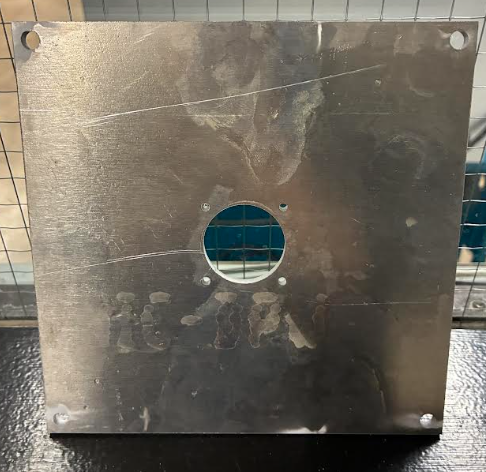
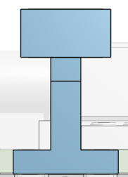
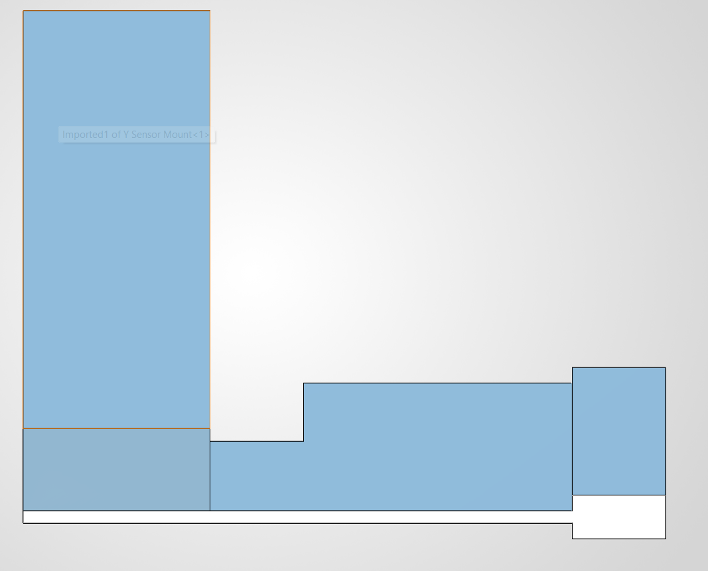
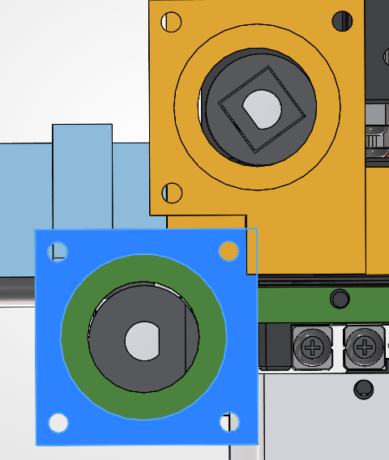
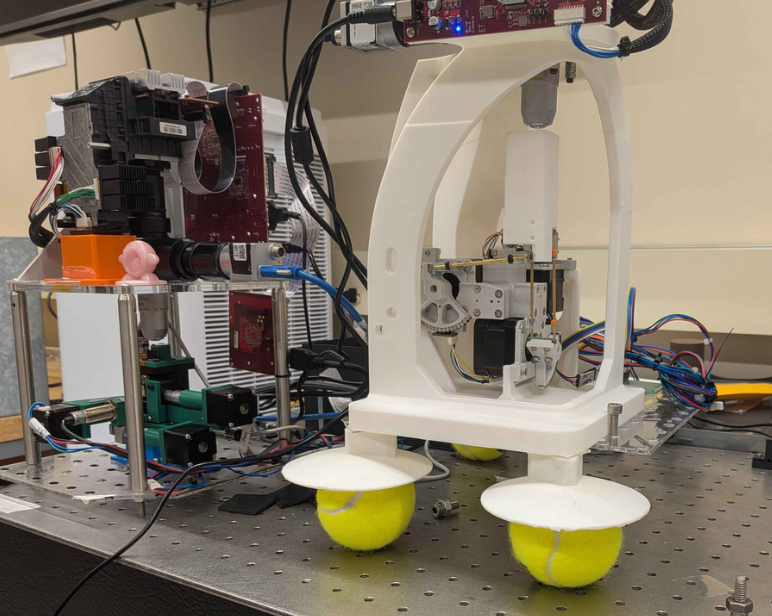
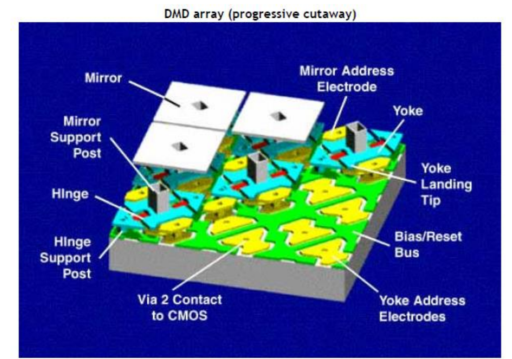

# Leonard Jin

I'm building the maskless lithography stepper. I'm also leading the gen one fab to design and assemble the machines by the end of Fall 2026 semester.

## Weekly Update #1 (11/9/26)
- TI Projector arrived
- DigiKey components arrived
- ThorLabs optical components arrived

**Waterjetting top plate**:I met up with Carson from GopherMotorsports who taught me how to waterjet. We waterjetted the top plate of the stepper that holds the projection system. Carson also said in the future motorsports is willing to share their scrap metal and we can also setup a way for us to purchase raw materials from them :D

**CAD assembly**: I've been building the complete CAD assembly for the stepper. I met up with Dominic a mechE who helped me with solidworks. I got the NEMA 11 stepper motors from grabcad.com and extrude cutted them in SolidWorks so that they matched the exact length of the motors we purchased. I also pulled the proximity sensors from grabcad and mated both the motors and the sensors to the xyz stage assembly. The inductive proximity sensors are interesting, going to create a short doc on how they work

I realized the 3d printed sensor mounts looked fragile and may break or wobble. This design could be intentional given that Sky from CMU said that they had poor tolerance with the xyz stage and told me to reachout to Carson (Calix on discord) to ask him about the design. I reached out and he hasn't responded yet. 

The Y and Z motor mounts for the stepper are overalapping at on point so I carved a rectangular notch in solid works to account for that overlap. I'm not sure how Harshit and Davit were able to assemble the xyz stage with two parts overlapping, but we will have to reprint the motor mounts.

**XYZ Stage frame**: One of the goals is to improve positioning accuracy of the stepper. I was curious about CMU's stepper frame design so I reached out to Toby from CMU. Toby came up with the cool frame and the tennis ball dampeners at the bottom. The design made the optical and stage one rigid system so vibration effects would be mitigated. Reminds me of a common-mode amplifier in analog design. Tennis balls just worked and that was clever. Toby kindly shared the cad models and 3d printing setup. He mentioned if we can't print this large frame, I can slice sit in half and superglue the parts together. I will recreate this frame for our stepper once midterms are over, right now our current design does not require this frame

**XYZ Stage base plate**: We need a base plate which in cmu's case was an optical table (which doesn't have pneumatic vibration dampening) its just a table with screw holes. I emailed Prof. Ilic and asked him if he had an extra optical breadboard, if not we can 3D print a base plate that serves the same purpose. Ideal Vacuum Products also makes optical breadboards for about $80 so maybe we can ask them for one.

**DMD and DLP research**: I've also done a lot research on DMDs. They are 3 layer that are fabricated MEMS devices. The digital miromirror device (DMD) in the TI Digital Light Processing (DLP) projector uses a specific type of optical mems device known as a spatial light modulator. I will do more research and organize my findings into a presentation to explain this projection system from the ground up. I also sent an email to Larry Hornbeck the inventor of the dmd dlp projection system, currently a professor at UT Austin.

**Onris' talk**: After Onri's talk I looked into using egg-whites as the resist. According to paper Onri referenced you need light in the DUV range around 230nm for the patterning process to work. Setting up an optical system for DUV projection is going to be difficult and hasn't been done DIY. There are also safety issues with light in the DUV range. However, we can spin on egg-whites and if we can get our hands on some film thickness characterize equipment like ellipsometer and/or profilometer we can measure the film's thickness and surface uniformity. That would be an interesting expirement
