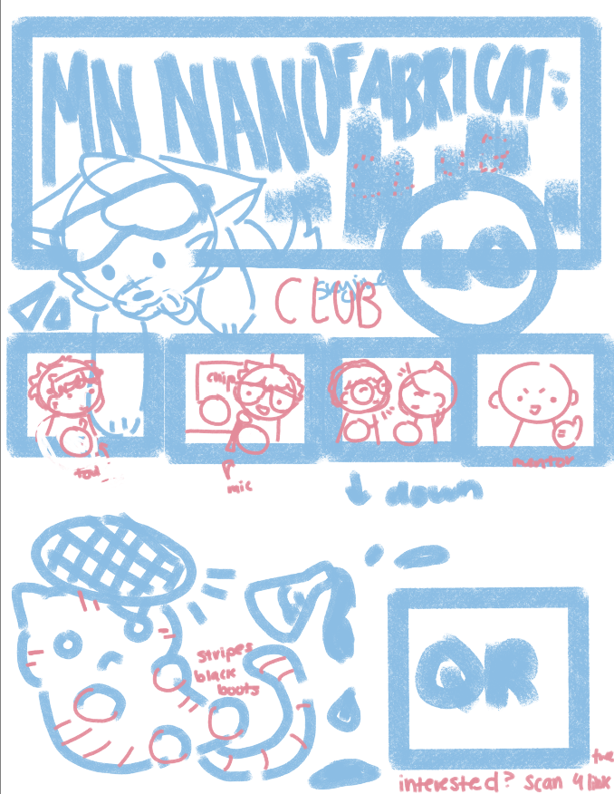
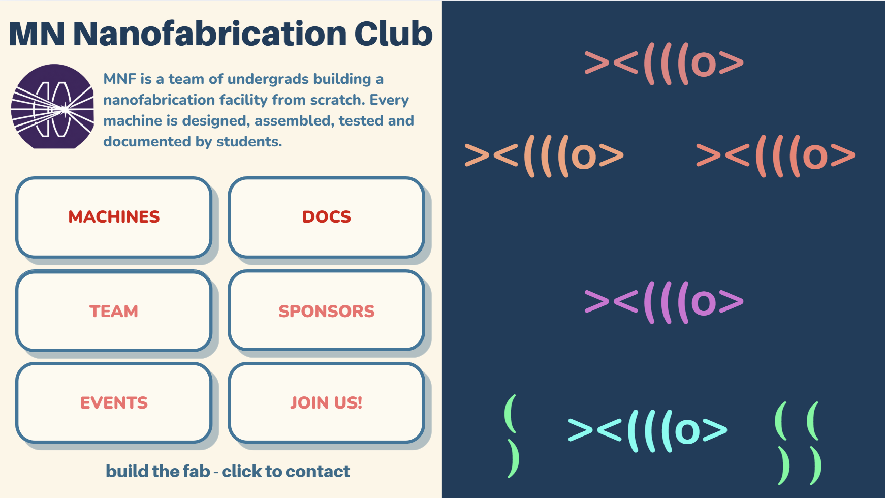

# Natalie Sinn

⋆˙⟡ ⋆.˚ ⊹₊⟡ ⋆ Hello! I'm the events and marketing director, and also the Logistics lead :) My page will have weekly updates on all of logistics! ⋆˙⟡ ⋆.˚ ⊹₊⟡ ⋆

  
*＊✿ All my flyers ✿＊*

      

## The Wonderful Logistics Team 

Finance Director: Nathan Van Berkom

Faculty and Sponsor Outreach Directors: Rhys Peene, Alexander Weimer

Grants and Funding Director: Sophia Pung, Ayaan Bhola

Website Developer: Isaac Holmdahl

## Weekly Update #2 (24, Nov. 2026)

Finance: Still waiting for the EIN to get here, but have we mentioned we're fully incorporated?! The Google form to report spent funds, along with requesting funds, has been finalized! Now we just need people to start filling it out when they start buying things! 

Faculty and Sponsor Outreach: Rhys is still waiting for responses from AJA International and Entegris, but also reached out to SAMCO inc. this week!  

Events and Marketing: The event with Nick was a success! About 18 people came to the talk and enjoyed lots of soda and (food) chips :) With no other events planned for the semester, I've started to work on a general flyer for the club, just to get our name out there! 

Website Development: Isaac and I are cooking with so many ideas; it's hard to choose one! One of our most promising ideas is having ASCII fish swimming around the website, with users being able to feed them with a click of their mouse. We're still finalizing and fiddling with the exact layout and content to add, so still subject to change, but I'm so excited to see what we choose! 

## Weekly Update #1 (17, Nov. 2026)

Finance: We're still waiting for the EIN to be mailed to us so we can open a Huntington Bank account! In the meantime, Nathan has been refining our ledger, bill of materials (BOM), expense submission, and expense request system. 

Faculty and Sponsor Outreach: Rhys reached out to AJA International and Entegris for possible sponsorship funding for the ICP-RIE Funding and is awaiting a response. Our flyer for Nick's talk also got reposted on the ECE Instagram page; hoping for a great turnout! 

Grants and Funding: Sophia has signed up for a meeting with Lightcone Infrastructures on Nov. 25th! 

Events and Marketing: Chips (the food kind) and soda have been secured for our event this Friday (20, Nov) and the attendance form has been created. I've also set up the GitHub documentation page (what you're reading) and learned how to colour text with HTML! 

Website Development: Isaac and I have been in the talks about ideas for a new, creative landing page for the club's main website! Let's see what we come up with in the future ~
